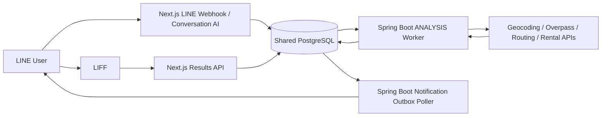

# Ownership / flow



- Conversation Stage (Next.js): webhook, conversations, preference extraction, readiness, creates `analysis_jobs` type `ANALYSIS`.
- Research Stage (Spring Boot): claims `ANALYSIS`, fetches actual evidence and scores, stores **full JSON** in `analysis_results`.
- Notifications (Spring Boot): reads `notification_outbox`, sends **short preview and link** to LINE.
- Results (Next.js): verifies LINE authentication / ownership, reads full JSON from DB for LIFF.

## Enqueue contract example (Next.js transaction)

```sql
INSERT INTO analysis_jobs (
  session_id, job_type, status, idempotency_key, profile_version, input_snapshot
) VALUES (
  :sessionId, 'ANALYSIS', 'QUEUED', :uniqueIdempotencyKey, :profileVersion,
  CAST(:immutableProfileJson AS jsonb)
);
```

Only create a job when minimum profile inputs are available. Keep `input_snapshot` immutable after enqueue. The worker MUST use this snapshot rather than the current session profile.

## Result transaction contract (to implement)

```sql
BEGIN;
INSERT INTO analysis_results(job_id,profile_snapshot,scoring_version,result_data)
  VALUES (:jobId, :profileSnapshot::jsonb, :version, :fullAnalysis::jsonb)
  ON CONFLICT (job_id) DO NOTHING;
UPDATE analysis_jobs SET status='COMPLETED',progress=100,completed_at=now(),
  lease_until=null,locked_by=null,updated_at=now()
  WHERE id=:jobId AND locked_by=:workerId AND lease_until>now();
INSERT INTO notification_outbox(user_id,analysis_result_id,payload)
  VALUES (:userId,:analysisResultId,:previewAndLiffUrl::jsonb)
  ON CONFLICT (analysis_result_id,notification_type) DO NOTHING;
COMMIT;
```

Implement this as one short transaction **with ownership check first**; if lease has expired, roll back rather than commit results from a stale worker. Make the result/retry path idempotent.
